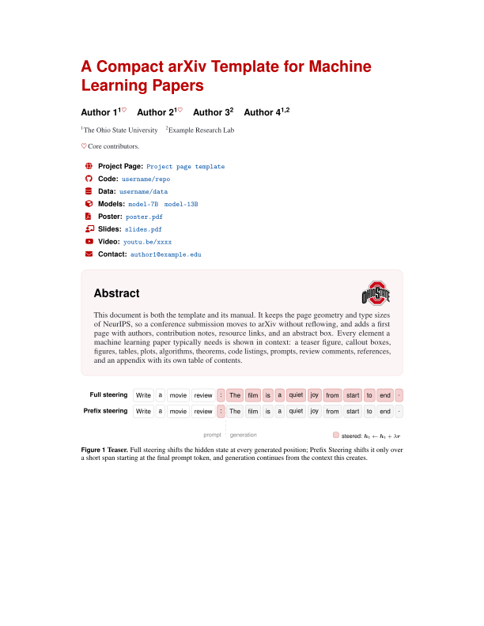

# Research Templates

LaTeX templates for what a research project makes: the arXiv paper, the conference poster, and the project roadmap. Each folder is self-contained. To use one, copy its folder into the project; improvements found while using it go back into the template here. The code template is [ai-research-template](https://github.com/xzAscC/ai-research-template), and the project page template lives in the [website repository](https://github.com/xzAscC/xzAscC.github.io).

On Overleaf, set the main document (Menu → Main document) to the template you compile: `arxiv/main.tex`, `poster/poster.tex` or `roadmap/Roadmap.tex`.

## arxiv

A compact LaTeX template with a customizable title page, resource links, an optional outline, and matching paper elements.

[View the example PDF](arxiv/example.pdf) · [Explore the source](arxiv/main.tex)

[](arxiv/example.pdf)

1. Copy `arxiv/`, `latexmkrc` and `arxiv_upload.py` into the project.
2. Write the text in `sections/`, one file per section; `main.tex` holds only the preamble, the title block and the order of the sections. Add references to `reference.bib`, and replace `logo.pdf` with your own logo.
3. Compile with a recent TeX Live installation:

   ```sh
   latexmk -pdf main.tex
   ```

A conference version shares the same text. Put it in a folder beside `arxiv/` (e.g. `iclr2027/`) with the conference's style files, and write its main file with the conference's style and the same lines as `arxiv/main.tex`: `\input{macro}`, `\input{sections/introduction}`, …, `\bibliography{reference}`. The `latexmkrc` at the project root adds `arxiv/` to the search paths, on Overleaf and locally, after the current folder.

To upload to arXiv, run `python3 arxiv_upload.py` at the project root: it builds the paper and writes `arxiv-upload.zip` (and the folder `arxiv-upload/`). arXiv publishes the source, so the upload holds one `main.tex`, with `sections/` and `macro.tex` inlined by `latexpand`, without comments and without the review notes `\zz` and `\xz` (`\revise` and `\edit` keep their text), and only the files the build reads: `arxiv.sty`, the logo and the figures (`../figs/` becomes `figs/`), `reference.bib`, which arXiv runs BibTeX on, and the built `main.bbl`. Check the PDF that arXiv builds before you submit.

The [example PDF](arxiv/example.pdf) and [`main.tex`](arxiv/main.tex) document the layout, commands, and customization options.
Before sharing your paper, disable review comments by commenting out `\showcommentstrue` in `macro.tex`.

## poster

A conference poster after the card layout of the NeurIPS 2025 poster "Projecting Assumptions: The Duality between Sparse Autoencoders and Concept Geometry" (Hindupur, Lubana, Fel, Ba). The poster is almost only figures. The message is a sentence or two, split into parts; each part is the heading of a card that holds the figure for it, so the headings, read in order, make the sentences.

Layout: a white title band with the university's logo on the left, the title, authors and institute in the middle, and the conference's logo on the right; a first row with the main claim, a teaser figure and a QR code; then rows of white cards on a light gray page. Colours come from the paper's figures (the `paper-figures` skill): text in its ink, headings in slate blue, outlined boxes in the paper's method colours. Text and math use Source Sans Pro, the font of the same skill. Made with `beamerposter` and the theme `beamerthemeposter.sty`, compiled with pdflatex (Overleaf's default), so it compiles inside a paper's Overleaf project. The university's logo is Ohio State's Block O (`osu-block-o.pdf`, from our earlier InDesign poster); until the conference's logo is added, a dashed box named `conference-logo` marks its place.

New poster:

1. Copy `poster/` to `<project>/poster/`, and put the conference's logo beside `poster.tex` as `conference-logo` (PDF, PNG or JPG).
2. In `poster.tex`, set the paper size and text scale (the `beamerposter` line; default 48 × 36 in landscape with 36pt body text), the accent colour (the colour the paper's figures give its method) and the title fields.
3. Write the sentences, split them into the card headings, and give each card its figure.
4. `latexmk -pdf poster.tex`.

`\begin{cardrow}{f}` is a row f of the page's height (the rows' f add up to 1); a row has 24 columns, and `\begin{card}{n}{heading}` spans n of them. `\fig{file}` fits a figure into its card. The first row's `herocard` holds `\claim`, `\statement` and `\qrlink`; `outlinebox` frames an equation, and theorems sit in one. `\placeholder{height}{label}` marks a figure's place while drafting.

## roadmap

A project's roadmap as a LaTeX document, first used in the Prefix Steering project. Its form follows two sources:

- The Specific Aims page of NIH grant applications: a central question, then for each aim its hypothesis, approach, expected outcomes, potential problems and alternatives, and how success is judged. Here these are the fields Hypothesis, Theory and Experiment, Outcomes, Risks and Done when; Paper says whether the aim goes into this paper or a follow-up.
- Steinhardt, "Research as a Stochastic Decision Process" (2018), for the order: within the aims, the cheap step most likely to fail comes first.

`\todo`, `\doing`, `\done` and `\dropped` draw the `[ ]`, `[/]`, `[x]` and `[-]` of our task lists; `\blank` marks a field not written yet. The reading list at the end holds the papers we read for the project, by category: `\item[\todo] \paper{key}{Why we read it.}` prints the full reference from `Roadmap.bib` with natbib's `bibentry` (there is no biber here, so no biblatex), and `\first` marks a paper to read first. Compiled with pdflatex and bibtex.

New roadmap:

1. Copy `roadmap/` to the project root.
2. Fill the fields marked with a dash; copy the Aim A section for each further aim.
3. Add a paper: its BibTeX from the `bib-lookup` skill into `Roadmap.bib`, then its `\paper` line under its category.
4. `latexmk -pdf Roadmap.tex`.

## TODO

- [x] arxiv: the text in `sections/`, shared with a conference version; `arxiv_upload.py` for arXiv.
- [x] poster: the conference logo's placeholder.
- [ ] Project page and personal website (website repository): not finished; revise.
- [ ] Add a slides template.
- [ ] Add a video template, with the demo video as one of its outputs.
- [ ] Add a model card to the code template.
- [ ] Add a research log and an AI collaboration statement.
- [ ] Submit the template to the Overleaf Gallery.

## License

The template code and documentation are available under the [MIT License](LICENSE).
The Ohio State University logos (`arxiv/logo.pdf` and `poster/osu-block-o.pdf`, also shown in the previews) are excluded from this license; replace them for your own work.
